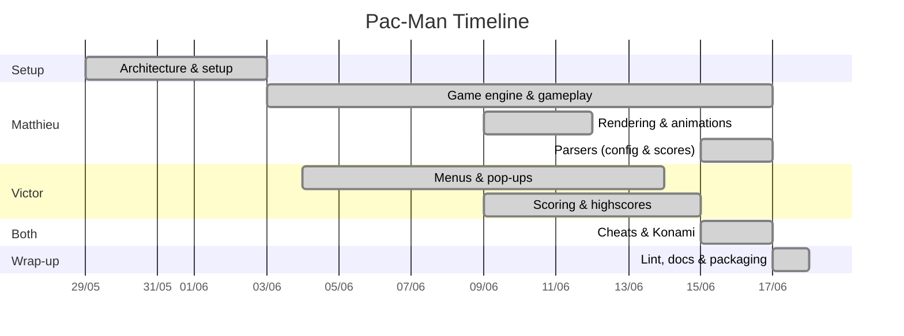

# Project Plan - Pac-Man

**Team:** Matthieu Dourdoigne (`mdourdoi`) · Victor Quétier (`vquetier`)

**Period:** 29 May 2026 => 18 June 2026

**Companion files:** `journal-mdourdoi.md`, `journal-vquetier.md` (per-person
day-to-day logs).

> Tracking was kept informally during the project (in-person + a Discord
> thread) and is consolidated here from the Git history (80+ commits,
> per-feature branches), which is the evidence trail.

## Approach

Incremental, Git-driven development:

- Each feature on its **own branch** (`parser`, `engines`, `game_engine`,
  `input_handler`, `feat/renderers`, `cheat_engine`, `feat/konami_code`,
  `mypy`, `feat/readme`...), merged into `main` after **cross code review**.
- **Coordination** in person and on Discord, technical choices discussed there,
  then validated through review on the branch before merge.

## Team organization

| Area | Owner(s) |
|---|---|
| Initial architecture & setup | Matthieu & Victor |
| Game engine, entities & input | Matthieu |
| Game rendering (sprites, maze, animations) | Matthieu |
| Config & score parsing | Matthieu |
| Menus, pop-ups, UI & fullscreen | Victor |
| Scoring & highscores (score register) | Victor |
| Cheats & Konami code | Matthieu (logic) · Victor (rendering + Konami) |
| Lint/type compliance & packaging | Matthieu & Victor |
| Documentation (docstrings, README) | Victor |
| Cross code review | Matthieu & Victor |

**Decisions** were made on Discord / in person and validated by code review on
the feature branch. **Issues** were reproduced, isolated (using `git checkout [commit hash]`
for the trickiest), fixed on a branch, reviewed, then merged.

## Timeline

| Week | Dates | Focus |
|---|---|---|
| W0 | 29/05 – 31/05 | Base structure, repo setup (Victor) |
| W1 | 01/06 – 07/06 | Scaffolding: instances, engines, input, first GameEngine, ghosts, first playable, menu engine, window handler, renderer base |
| W2 | 08/06 – 14/06 | Collisions/hitbox, sprites, rounded maze, animations, end-of-game, pop-ups, scores/controls engines, pause, fullscreen |
| W3 | 15/06 – 18/06 | Parsers, GameEngine reset, cheats + Konami, score register, lint/type pass, docs, itch.io packaging |

**Planned vs actual:** planning was lightweight and incremental (global architecture first, then core gameplay and UI/systems in parallel, polish last).
Core gameplay landed on time
(first playable ~07/06), parser hardening and the once-per-level end-of-game
fix slipped to W3, quality and packaging were concentrated at the very end
(17–18/06). 

## Key choices

| Choice | Rationale |
|---|---|
| Stack of engines + `orchestrator`, `update_always` vs `update_focus` | Clean overlay of menus/pause/cheats over the game, only the focused engine reacts to input. |
| Engine / renderer separation | Logic stays testable, renderers only read engine state. |
| `GameEngine.reset()` resets **in place** | The renderer holds the engine reference and GPU resources (textures, maze `RenderTexture`), a new instance would orphan them. |
| Grid + interpolation | Smooth movement and a "fake" hitbox feel without leaving the grid. |
| Maze cached in a `RenderTexture` | Drawn once, blitted each frame. |
| Tolerant parsers (config clamps to defaults, scores degrade to `[]`) | Subject forbids tracebacks on bad input. |
| PyInstaller + itch.io | Standalone build, no Python install. Itch is free and supports unlisted builds. |

## Risks & mitigation

| Risk | Mitigation |
|---|---|
| Path resolution when frozen (assets/config) | Assets via `sys._MEIPASS`, config/highscore next to the exe (`chdir`), test from a clean dir. |
| Malformed user config/score files | Defensive parsers, graceful degradation, no traceback. |
| Maze too small | Minimum dimensions enforced in the config parser. |
| Scope vs time (broad subject, 2 people) | Feature branches, incremental delivery, core gameplay first. |

## Acceptance & bugs

Testing = **manual playtesting** (gameplay, UI, edited config/score files). All listed features
pass, the packaged build launches from a clean directory.

Key bugs found and fixed:

- **Single keypress filled the whole name** - `end_game` ran every frame from
  `update_always`, re-pushing `SCORE_REGISTER` onto the stack => fixed by moving
  the trigger back to `update_focus` (isolated via `git checkout [commit hash]`).
- **"WIN LEVEL" cheat wrong effect** - misaligned `ACTIONS` map => realigned.
- **Highscore file truncated each launch** - `'w'` open => switched to `'a'`.
- **Crash on empty/invalid files** - parsers re-raised => graceful degradation.
- **Lint/type errors** (texture-filter enum, float/int args, nested call) =>
  fixed for `make lint` to pass.
- **"maze too small" in packaged build** - used default config => load `config`
  next to the executable.
- **Inexistant config or highscore file** - use default config and create a new highscore file.

## Blocking points & lessons

- **Name-entry regression**: hard to locate (looked like a keyboard issue, was
  an engine-stack issue).
- **Packaging paths**: frozen build had no sprites / tiny maze, fixed with
  `_MEIPASS` + external config.
